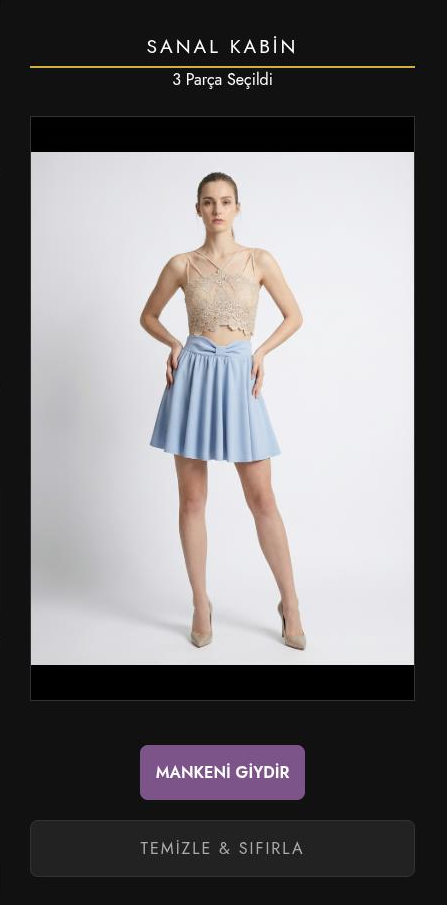

# Fashion Recommender — Yapay Zeka Destekli Moda Asistanı

Lisans bitirme projesi. E-ticarette ürün keşfi, kombin uyumsuzluğu ve görselleştirme 
eksikliği sorunlarına yönelik üç modüllü yapay zeka tabanlı bir moda asistanı.

## Ekran Görüntüleri

| Akıllı arama | Kombin önerisi | Sanal manken |
|:---:|:---:|:---:|
|  |  |  |

## Modüller

**1. Akıllı Arama**  
TF-IDF vektörizasyonu ve kosinüs benzerliği ile Türkçe metin sorgularını işler.
74.852 ürün içinde 100 test sorgusunda ortalama 0.34 saniyede sonuç döner.

**2. Kombin Önerisi**  
68.306 gerçek kombinasyondan çıkarılan 749.640 co-occurrence kuralıyla tamamlayıcı
ürün önerisi sunar. Kural bulunamayan durumlarda renk teorisi ve mevsim uyumu devreye girer.

**3. Sanal Manken**  
Google Gemini 3 Pro ile seçilen kombini 2K çözünürlükte bir manken üzerinde görselleştirir.
27 denemede hatasız görsel üretildi, ortalama üretim süresi 18.4 saniye.

## Teknolojiler

**Backend:** Python, Flask, Pandas, NumPy, Scikit-learn  
**Frontend:** React 18, Vite, Tailwind CSS  
**AI:** TF-IDF + Kosinüs Benzerliği, Co-occurrence Analizi, Google Gemini 3 Pro  
**Optimizasyon:** Singleton Pattern, Sparse Matrix (NPZ)  
**Veri Seti:** Polyvore Outfit Dataset — 74.852 ürün, 749.640 kombinasyon

## Kurulum

### Backend

```bash
cd backend
python3 -m venv venv
source venv/bin/activate
pip install flask flask-cors python-dotenv pandas numpy scikit-learn scipy pillow google-genai
python3 app.py
```

### Frontend

```bash
cd frontend
npm install
npm run dev
```

## Proje Hakkında

Mehmet Akif Ersoy Üniversitesi, Yazılım Mühendisliği — Bitirme Projesi  
Geliştirici: Sümeyye İsen | Danışman: Doç. Dr. İhsan Pençe | 2025-2026

## API Anahtarı

`backend/` klasöründe bir `.env` dosyası oluşturup Google Gemini anahtarını ekleyin:

    GOOGLE_API_KEY=anahtariniz
